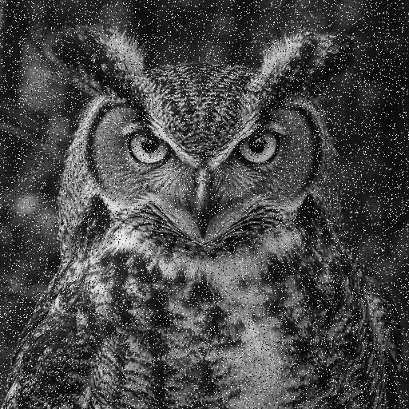
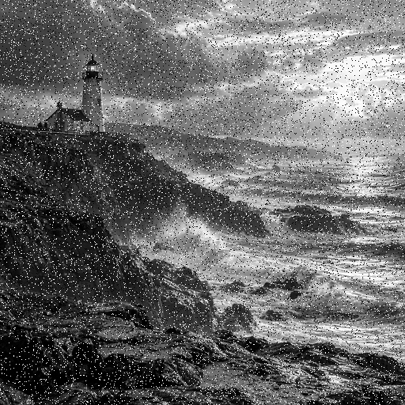
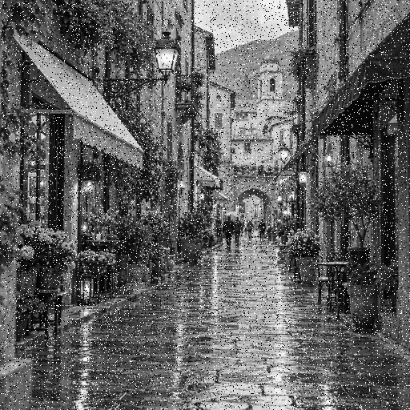
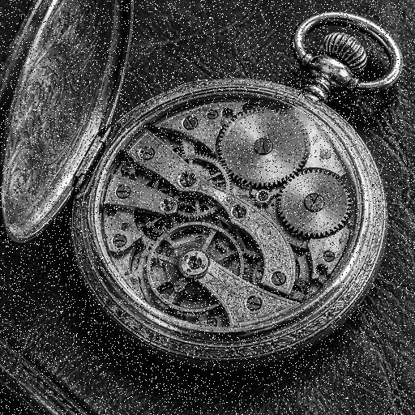

# G40_Dividir-e-Conquistar_PA-26.2

Número da Lista: 40<br>
Conteúdo da Disciplina: Dividir e Conquistar

## Alunos

| Matrícula | Aluno |
| --------- | ----- |
| 231011515 | Isaque Camargos Nascimento |
| 231011088 | Ana Luiza Soares de Carvalho |

<table>
  <tr>
    <td align="center">
      <a href="https://github.com/Ana-Luiza-SC">
        
        <br />
        <sub><b>Ana Luiza Soares</b></sub>
      </a>
    </td>
    <td align="center">
      <a href="https://github.com/isaqzin">
        
        <br />
        <sub><b>Isaque Camargos</b></sub>
      </a>
    </td>
  </tr>
</table>

## Sobre

Este projeto apresenta uma aplicação gráfica para redução de ruído sal e pimenta em imagens em tons de cinza. O filtro utiliza o algoritmo **Mediana das Medianas**, uma estratégia de Dividir e Conquistar para selecionar a mediana de uma janela de pixels sem precisar ordenar todos os seus elementos.

A aplicação permite abrir uma imagem, adicionar ruído artificial, acompanhar o processamento em tempo real e comparar a imagem original, a versão ruidosa e o resultado filtrado. A visualização antes/depois possui divisor ajustável, zoom e barras de rolagem.

## Mediana das Medianas

Para encontrar a mediana, o algoritmo executa os seguintes passos:

1. divide os valores em grupos de cinco;
2. ordena cada grupo e coleta sua mediana;
3. encontra recursivamente a mediana das medianas para escolher um pivô;
4. particiona os valores entre menores, iguais e maiores que o pivô;
5. continua apenas na partição que contém a posição procurada.

Essa escolha determinística de pivô garante tempo linear no pior caso para a seleção. No filtro, o procedimento é aplicado à vizinhança de cada pixel.

O projeto utiliza uma janela de `15 × 15` pixels e substitui o pixel central quando a diferença em relação à mediana é maior que o limiar `40`.

### Complexidade

Considerando uma imagem de altura `H`, largura `W` e uma janela de lado `K`:

- seleção da mediana de uma janela: `O(K²)`;
- processamento completo da imagem: `O(H × W × K²)`;
- espaço auxiliar da seleção: `O(K²)`.

## Funcionalidades

- seleção de imagens pelo explorador de arquivos do sistema;
- adição opcional de ruído sal e pimenta;
- filtro baseado em Mediana das Medianas;
- barra de progresso real por linha processada;
- cancelamento do processamento;
- comparação lado a lado entre original, ruidosa e filtrada;
- visualização interativa antes/depois;
- zoom entre 25% e 300%;
- cálculo de PSNR das imagens ruidosa e filtrada;
- medição do tempo de execução;
- exportação da imagem filtrada.

## Imagens de exemplo

| Coruja | Farol |
| ------ | ----- |
|  |  |

| Rua | Relógio mecânico |
| --- | ----------------- |
|  |  |

## Estrutura do projeto

```text
.
├── images/                     # Imagens usadas nos testes
├── src/
│   ├── filtro.py               # Aplicação do filtro de mediana
│   ├── main.py                 # Interface gráfica
│   ├── mediana_das_medianas.py # Algoritmo de seleção
│   └── processamento.py        # Leitura, ruído, métricas e salvamento
├── README.md
└── requirements.txt
```

## Instalação

Linguagem: Python 3.12.3<br>
Dependências: NumPy, Pillow e Tkinter

### Ubuntu

Instale o Tkinter:

```bash
sudo apt update
sudo apt install python3-tk
```

Crie e ative o ambiente virtual:

```bash
python3 -m venv venv
source venv/bin/activate
```

Instale as dependências e execute o programa:

```bash
pip install -r requirements.txt
python src/main.py
```

### Windows

Crie e ative o ambiente virtual:

```powershell
py -m venv venv
venv\Scripts\activate
```

Instale as dependências e execute o programa:

```powershell
pip install -r requirements.txt
python src/main.py
```

## Uso

1. Clique em **Abrir imagem** e selecione um arquivo.
2. Marque ou desmarque **Adicionar ruído sal e pimenta**.
3. Clique em **Aplicar filtro**.
4. Acompanhe o percentual e a linha atual na barra de progresso.
5. Use as abas para comparar as três imagens ou explorar o antes/depois com zoom.
6. Clique em **Salvar resultado** para exportar a imagem filtrada.

## Vídeo

[Clique aqui para assistir ao vídeo.](https://youtu.be/2xr6SUKFuWE)
